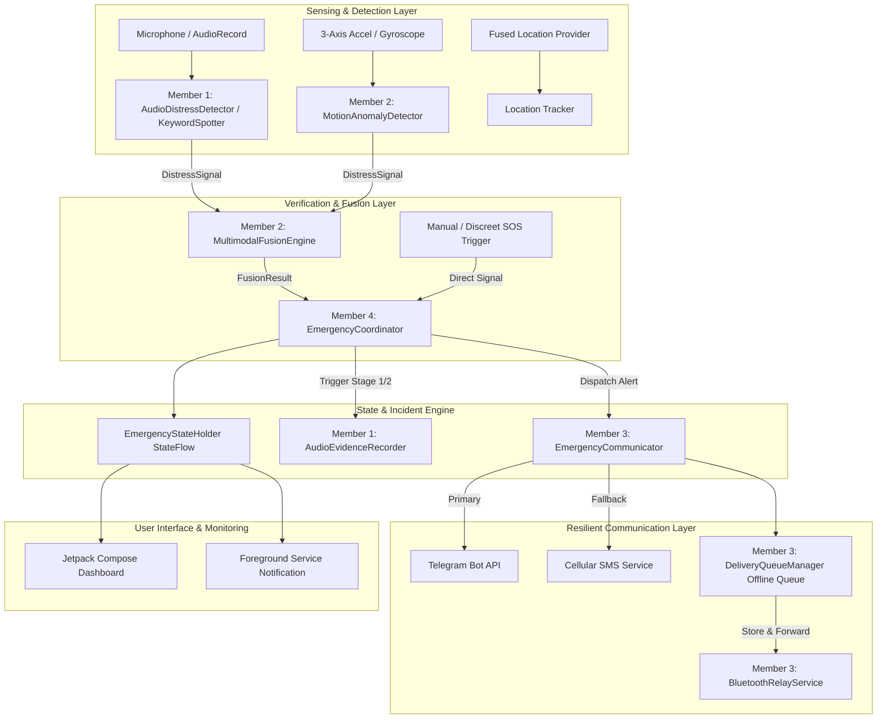
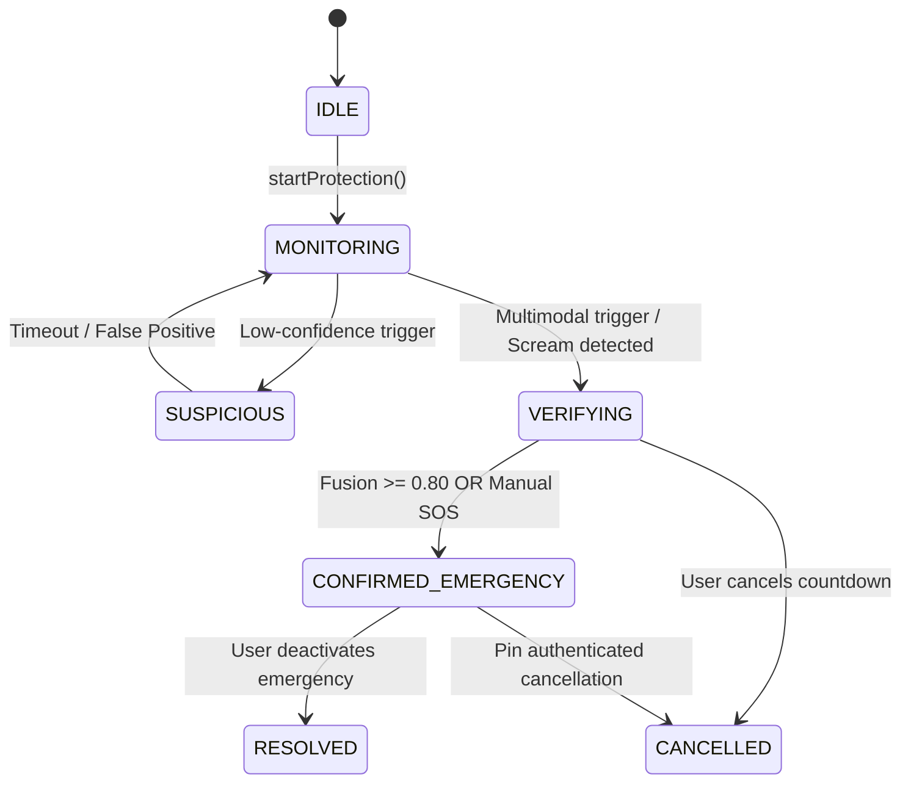

# GuardianGrid: System Architecture

## 1. Architectural Overview

GuardianGrid is engineered using a modular, decoupled reactive architecture on Android. The system isolates perception (sensing and classification), multimodal sensor fusion, emergency escalation, and multi-channel communication into clearly bounded subsystems.



---

## 2. Layered Component Architecture

### Layer 1: Ingestion & Perception Layer
- **Microphone Stream:** Continuous rolling buffer ingestion (16 kHz, 16-bit PCM mono).
- **Inertial Sensor Stream:** Hardware sensor listeners operating at `SENSOR_DELAY_GAME` or `SENSOR_DELAY_FASTEST` to capture peak G-force and rotation rates.
- **Location Engine:** Fused location client querying GPS and network providers for emergency positioning.

### Layer 2: Subsystem AI & Detectors
- **Acoustic Classifier (`modules/audio`):** Processes spectrograms through an on-device TFLite model to identify screams and vocal distress. Emits `DistressSignal(type = SCREAM, confidence)`.
- **Keyword Spotter (`modules/audio`):** Matches acoustic phonetic features against target hotwords ("Help", "Bachao"). Emits `DistressSignal(type = KEYWORD, confidence)`.
- **Motion Anomaly Detector (`modules/motion`):** Analyzes vector magnitude:
  $$|a| = \sqrt{a_x^2 + a_y^2 + a_z^2}$$
  Flags sudden freefall followed by high-g impact (fall detection) or rapid rotational oscillations (struggle). Emits `DistressSignal(type = MOTION_ANOMALY, confidence)`.

### Layer 3: Multimodal Fusion & Verification Engine (`modules/motion`)
- Operates a sliding time window (default: $3000\text{ ms}$).
- Combines cross-modal signals using confidence-weighted correlation:
  - Audio scream + impact/struggle $\rightarrow$ High combined confidence ($\ge 0.85$), initiates immediate escalation.
  - Isolated acoustic signal $\rightarrow$ Medium confidence, initiates suspicious countdown and Stage 1 buffer capture.
  - Isolated inertial spike $\rightarrow$ Low/filtered out if no acoustic corroboration occurs within the window.

### Layer 4: State Machine & Emergency Coordinator (`core/state` & `app`)
The system progresses through a deterministic finite-state machine:



### Layer 5: Resilient Communication & Offline Persistence (`modules/communication`)
- **Tier 1 (Internet / Telegram):** Dispatches rich markdown message, live GPS coordinates, Google Maps URL, and forensic audio link to trusted contacts and emergency channels via Telegram Bot API.
- **Tier 2 (Cellular SMS Fallback):** If HTTP dispatch fails or network is disconnected, formats a compact carrier SMS:
  `EMERGENCY ALERT: GuardianGrid detected distress at https://maps.google.com/?q=LAT,LON`
- **Tier 3 (Local Persistence Queue):** All outbound alerts are saved to SQLite/Room. Failed alerts enter exponential backoff retry cycles.
- **Tier 4 (Bluetooth Relay):** In complete network blackouts, broadcasts encrypted emergency beacons over BLE for store-and-forward forwarding by other nearby GuardianGrid installations.

---

## 3. Two-Stage Audio Intelligence Architecture

```
Normal Ambient Audio ───► Circular Rolling Buffer (3-5 sec in RAM)
                                    │
                                    ▼ (Suspicious / Correlated Trigger)
                           [ Stage 1 Audio Dump ]
                           Saved to internal cache: stage1_preview.wav
                                    │
                                    ▼ (Confirmed Emergency Escalation)
                           [ Stage 2 Audio Evidence ]
                           Continuous recording: evidence_segment_N.aac
                           Transmitted to trusted contacts & local audit trail
```

1. **Privacy Invariant:** Ambient audio is kept strictly in volatile RAM as a circular buffer and overwritten continuously. It is never persisted to disk or sent over network unless a verified distress threshold is exceeded.
2. **Forensic Integrity:** When escalated, segments are timestamped and preserved with SHA-256 integrity hashes in the local audit log.
