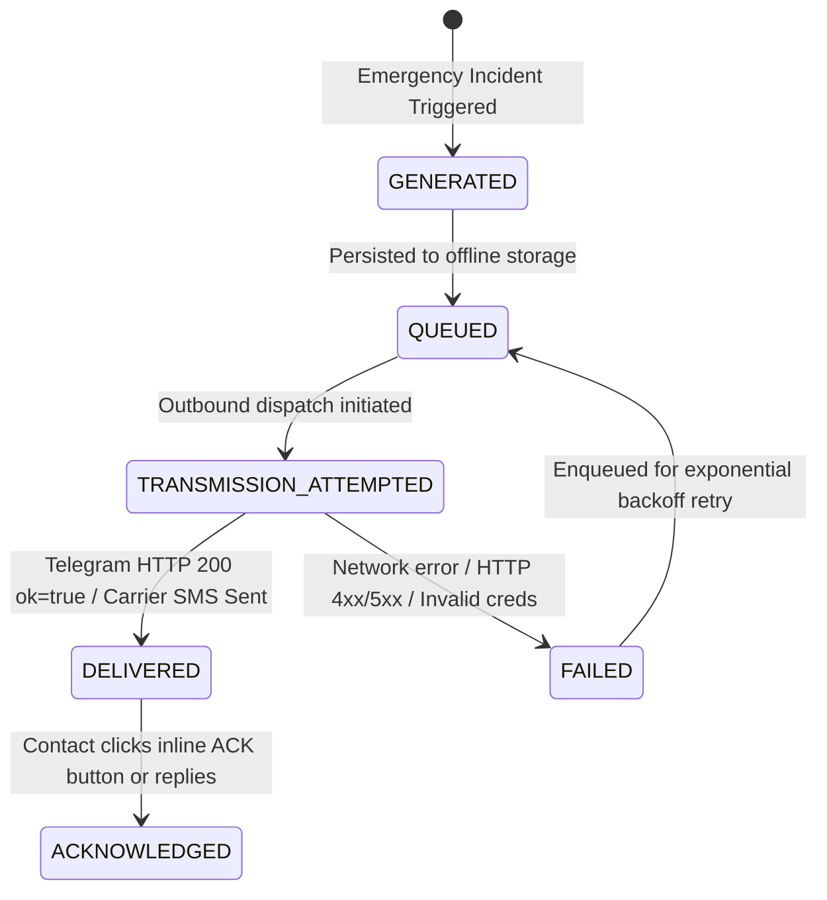

# Communication Subsystem (`modules/communication`)

**Subsystem:** Resilient Multi-Channel Emergency Dispatch & Offline Persistence  
**Owner:** Member 3  
**Target Branch:** `feature/communication`  
**Status:** Implemented & Verified  

---

## 1. Overview & Architecture

The Emergency Communication subsystem provides GuardianGrid with an autonomous, resilient multi-tier notification pipeline designed to guarantee alert delivery even under extreme network disruption, dead-zones, and device interference.

```
                  ┌────────────────────────────────────────┐
                  │       AlertPayload (Emergency Event)   │
                  └──────────────────┬─────────────────────┘
                                     │
                        [ IdempotencyManager ]
                        (Check duplicate event)
                                     │
                      [ RecipientAuthorizer ]
                      (Sanitize & verify privacy)
                                     │
             ┌───────────────────────┴───────────────────────┐
             ▼                                               ▼
     [ Tier 1: Primary ]                             [ Tier 2: Fallback ]
  TelegramEmergencyDispatcher                      SmsEmergencyDispatcher
  • Markdown Alert with GPS Map Link              • Compact 160-char SMS
  • Inline Acknowledgment Button                  • SmsManager Single-Segment
  • Message ID Tracking                           • Cellular Radio Only
             │                                               │
             ├─────────────── Failure ───────────────────────┤
             ▼                                               ▼
  [ DeliveryQueueManager ]                        [ Tier 3: Foundation ]
  • Local Persistence (SQLite/File)             BluetoothRelayServiceImpl
  • Exponential Backoff Retries                 • Compact BLE SOS Beacon
  • Delivery Status Tracking                    • Store-and-Forward Relay
```

---

## 2. Delivery State Lifecycle

To ensure total transparency and avoid premature claims of delivery, alerts transition through six strictly enforced states:



| State | Definition | Invariant |
| :--- | :--- | :--- |
| **`GENERATED`** | The emergency event payload has been constructed. | Not yet queued or sent. |
| **`QUEUED`** | Stored in local persistent queue awaiting dispatch. | Survives process termination and reboot. |
| **`TRANSMISSION_ATTEMPTED`** | Outbound network/SMS transmission in-flight. | Never report as delivered at this step. |
| **`DELIVERED`** | API accepted the message (HTTP 200 `ok: true`) or carrier SMS sent. | Distinguishes platform delivery from human acknowledgment. |
| **`ACKNOWLEDGED`** | An authorized human recipient actively clicked the inline button or replied. | Confirms human awareness and response. |
| **`FAILED`** | Transmission rejected, network unreachable, or credentials invalid. | Triggers channel fallback and local queueing. |

---

## 3. Telegram Bot API Integration

### Message Format
Outbound alerts format high-priority Markdown notifications:
- **Header:** `🚨 GUARDIANGRID EMERGENCY ALERT 🚨`
- **Telemetry:** Incident ID, Distress Type, Confidence Score, UTC Timestamp.
- **Location Link:** Clickable Google Maps URL (`https://maps.google.com/?q=LAT,LON`) with accuracy radius ($\pm X\text{m}$). If GPS fix is unavailable, gracefully displays `UNAVAILABLE (GPS fix not acquired / indoor dead-zone)` without broken links.
- **Audio Evidence:** Reference attached only if recipient is an authorized primary contact.
- **Interactive Acknowledgment:** Inline Keyboard button `[ ✅ Acknowledge Receipt (Help on the way) ]` with callback data `ack:<incidentId>`.

### Human Acknowledgment Polling
- Invokes `GET /getUpdates?allowed_updates=["callback_query","message"]`.
- Identifies callback queries matching `ack:<incidentId>`.
- Transitions alert status to `ACKNOWLEDGED`, recording responder name, user ID, and timestamp in the local audit trail.

---

## 4. SMS Fallback Feasibility & Architecture

### Architectural Feasibility Assessment
1. **Underlying Android APIs:**
   - Android 12+ (API 31+): `context.getSystemService(SmsManager::class.java)`
   - Android 8.0–11 (API 26–30): `SmsManager.getDefault()`
2. **Permission Model:**
   - Requires `android.permission.SEND_SMS` (declared in `AndroidManifest.xml` and requested at runtime).
3. **Google Play Store Policy:**
   - `SEND_SMS` is restricted under Google Play's Sensitive Permissions Policy.
   - GuardianGrid qualifies under the **Personal Safety Application Exception** declaration.
4. **GSM 7-bit Character Budget:**
   - Single-segment SMS limit: **160 characters**.
   - Compact template: `EMERGENCY: GuardianGrid SOS! Type: <TYPE>. Loc: <URL>. ID: <ID>`.
   - Guaranteed under 160 characters to eliminate multipart segmentation delays during critical carrier delivery.

---

## 5. Offline Queueing & Automatic Retries

- **Persistence Layer:** `FileEmergencyQueueRepository` / SQLite database guarantees alert durability across phone reboots and app termination.
- **Exponential Backoff:**
  $$\text{Delay} = \min\left(\text{BaseDelay} \times 2^{\text{retryCount}}, \text{MaxDelay}\right)$$
  *(Base: $2000\text{ ms}$, Max: $60\text{ s}$, Max Retries: $5$)*
- **Network Recovery Hook:** `onNetworkRestored()` flushes pending queue items immediately upon connectivity restoration.

---

## 6. Security & Privacy Invariants

1. **No Hardcoded Secrets:** Telegram bot tokens and chat IDs are never committed to git. Managed via `TelegramConfigManager` through runtime injection, environment variables (`GUARDIANGRID_TELEGRAM_BOT_TOKEN`), or encrypted preferences.
2. **Token Masking:** `TelegramCredentials.maskedToken()` ensures logs and diagnostics display `123456:ABC***xyz` rather than plain-text secrets.
3. **Audio Evidence Access Control:** Non-primary or unauthorized contacts have audio evidence paths stripped from the payload by `RecipientAuthorizer`.
4. **Phone Number & Chat ID Masking:** Logged recipients are masked (e.g. `+155****567`).

---

## 7. Interfaces Implemented

- [`com.guardiangrid.core.interfaces.EmergencyCommunicator`](file:///d:/CudaCores/CudaCores/core/interfaces/CommunicationContracts.kt#L13)
- [`com.guardiangrid.core.interfaces.DeliveryQueueManager`](file:///d:/CudaCores/CudaCores/core/interfaces/CommunicationContracts.kt#L33)
- [`com.guardiangrid.core.interfaces.BluetoothRelayService`](file:///d:/CudaCores/CudaCores/core/interfaces/CommunicationContracts.kt#L54)

---

## 8. Verification & Test Coverage

All capabilities are verified through hermetic unit tests in [`tests/CommunicationModuleTest.kt`](file:///d:/CudaCores/CudaCores/tests/CommunicationModuleTest.kt):

- `testSuccessfulTelegramDelivery`: Validates HTTP POST payload, Google Maps link, and `DELIVERED` state.
- `testInvalidTelegramCredentials`: Validates HTTP 401 error handling and `FAILED` state.
- `testMissingLocationHandling`: Validates graceful fallback when GPS is missing.
- `testNetworkUnavailableTriggersQueueing`: Validates offline queueing on network failure.
- `testExponentialBackoffAndRetryWhenNetworkRestored`: Validates backoff schedule and auto-flush on network restoration.
- `testDuplicateAlertSuppression`: Validates `IdempotencyManager` prevents duplicate dispatch.
- `testDeliveryLifecycleDistinguishesApiDeliveryFromHumanAcknowledgment`: Confirms distinction between API 200 delivery and user button click acknowledgment.
- `testSmsFallbackDispatchAndCompactFormat`: Validates 160-char GSM budget and SMS dispatcher.
- `testAudioEvidencePrivacyRestriction`: Validates audio path removal for non-primary contacts.
- `testCredentialMasking`: Validates token and phone number masking.
- `testBluetoothRelayBeaconEncoding`: Validates 24-byte compact BLE beacon packing.
- `testFileQueuePersistenceAcrossRestarts`: Validates file persistence survives simulated process reboot.
